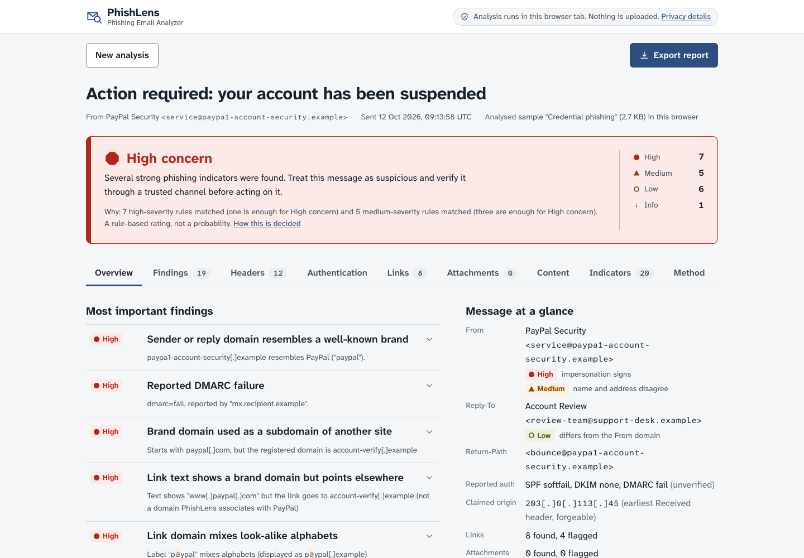
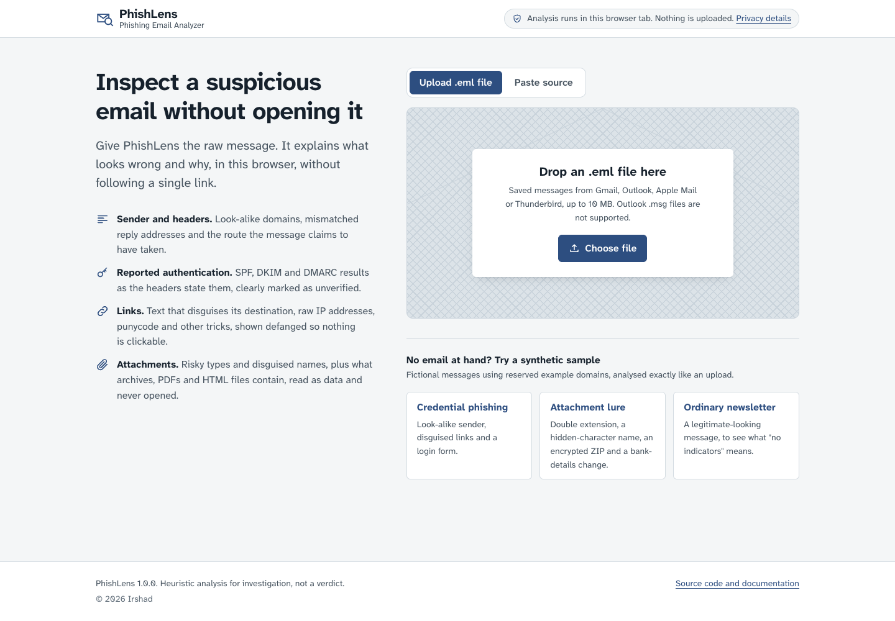
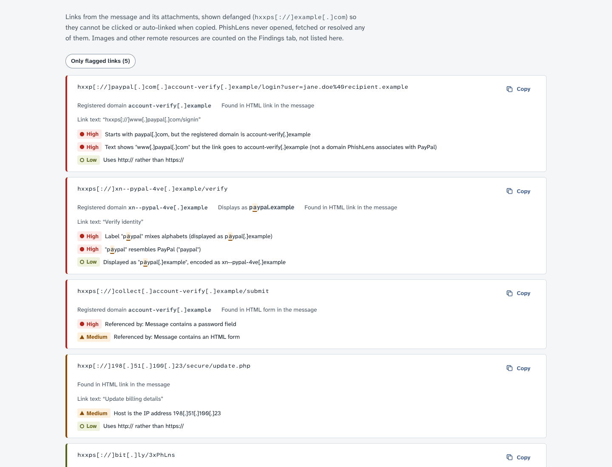
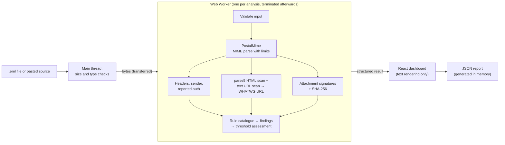

# PhishLens

[](https://github.com/Mayaar-Irshad/PhishLens/actions/workflows/ci.yml)

**Phishing Email Analyzer**, running entirely in your browser. Drop in a raw `.eml` file or paste a message's source, and PhishLens explains what looks suspicious and why, without uploading the message, opening its links, rendering its HTML or running its attachments.

**Live demo:** <https://mayaar-irshad.github.io/PhishLens/> (published by the Pages workflow once enabled; see [Deployment](#deploy-to-github-pages)). Three synthetic sample messages are built in, so you can try it without a real phishing email.



## Features

- **Email input.** Drop an `.eml` file anywhere on the page, choose one, or paste raw headers or a full raw message (pasting anywhere on the start screen works too). Text copied along with the headers, such as Gmail's "Show original" summary, is skipped automatically. A configurable size limit (10 MB by default) is checked before the file is read, and binary files, Outlook `.msg` files and text without headers are rejected with specific explanations.
- **Header analysis.** From, Reply-To, Return-Path, Sender, To, Cc, Subject, Date, Message-ID, Received, Authentication-Results and DKIM-Signature, including repeated headers (all values kept in order), folded headers and RFC 2047 encoded words. The Received chain is shown oldest-first, with IPs, protocols and time gaps.
- **Sender checks.** Reply-To and Return-Path domain mismatches, display names that contain a different address or impersonate a brand, brand names sent from free webmail, look-alike domains (`paypa1`, `rnicrosoft`, one-letter typos and swapped letters), domains written in full-width look-alike characters, internationalized and mixed-script domains, cousin domains of the recipient's or sender's organisation (`acrne-corp` for `acme-corp`), Microsoft 365 tenant domains, duplicate From headers, and From headers that list several mailboxes (a known DMARC bypass).
- **Reported authentication.** SPF, DKIM and DMARC results are parsed from `Authentication-Results` (RFC 8601, including Microsoft 365's variant), `Received-SPF`, ARC headers and `DKIM-Signature` tags. Everything is labelled **reported, not verified**, with an explanation of the trust boundary.
- **Link analysis.** Links come from HTML (anchors, forms, frames, meta refresh, `<base>`) and plain text. Each one is normalised with the WHATWG URL parser, so the host analysed is the host a browser would contact. PhishLens checks:
  - link text that shows a different domain than the real destination
  - raw and obfuscated IPs (`http://3325256727/`)
  - `user@host` tricks
  - `javascript:`, `data:` and other unusual schemes
  - punycode and homographs
  - brand domains used as subdomains
  - shorteners
  - shared hosting, tunnels and IPFS
  - redirect parameters and risky downloads

  Security-gateway wrappers (Microsoft Safe Links, Proofpoint, Mimecast, Barracuda, Trend Micro, Sophos, Cisco) are unwrapped, and redirect destinations (including Google AMP and Bing click-through links) are analysed in their own right. Links are also found in Outlook conditional comments, script redirects and bare domains in plain text. Every link is shown **defanged** (`hxxps[://]evil[.]example`), and non-ASCII letters in hosts are highlighted.

- **Attachment analysis.** Name, size, declared type, a file signature from the leading bytes, and a SHA-256 hash for manual lookup. Flags cover executables and scripts, double extensions, right-to-left-override names (with a preview of how they display), disk images, HTML/SVG, macro documents, OneNote files, encrypted ZIPs, and type or content mismatches. Attachment bytes are also inspected as data, never opened, rendered or extracted:
  - ZIP directories are listed, flagging executables, double extensions, HTML pages and encrypted entries hidden inside.
  - Office documents are checked for VBA macro projects, both `vbaProject.bin` in `.docx`-style files and `_VBA_PROJECT` in legacy OLE files.
  - PDFs get a pdfid-style census of `/JavaScript`, `/Launch`, `/EmbeddedFile`, `/OpenAction` and similar keywords, and their `/URI` links are extracted.
  - HTML and SVG attachments are parsed with parse5 for login forms, script redirects and HTML smuggling (an embedded payload decoded and saved by script).
  - Links in `.url` and `.webloc` shortcuts and in calendar invitations join the Links tab, labelled with the attachment they came from.

  Attached `.eml` messages can be analysed in turn.

- **Transparent assessment.** Every finding comes from a [documented rule](docs/RULES.md) with a fixed severity, a rationale, common legitimate causes and a recommendation. The overall assessment is a published threshold rule, not a probability, and it never declares a message safe.
- **Content view.** Read the message as inert plain text: visible text extracted from the HTML (hidden text excluded), the plain-text part, or the HTML source, with links defanged and hidden characters revealed. Previews stay in memory and are never exported.
- **Indicators of compromise.** Sender addresses, domains, public IPs, URLs and SHA-256 hashes in one defanged list with copy-all, plus the claimed originating IP and notable headers such as `X-Mailer`.
- **Reports for tickets.** Download a JSON report or copy a plain-text summary. Both hold findings, defanged indicators and hashes, with every domain, address and IP defanged. Recipient addresses are redacted by default, including percent-encoded, defanged and base64-encoded forms inside URLs and where an attacker spoofed the recipient as the sender. They never contain message bodies, raw headers or attachment contents. Next steps are given separately for the recipient and for the analyst.
- **Accessible interface.** Keyboard-operable tabs and disclosures, focus moved to the relevant heading after every navigation, screen-reader announcements, colour-independent severity markers, contrast-checked controls, UTC timestamps, light and dark themes, and responsive layouts down to phone width. The browser's Back button returns from results to the start screen, and no message data is ever placed in the URL.

| Input                                                                         | Defanged links with flags                                                                                         |
| ----------------------------------------------------------------------------- | ----------------------------------------------------------------------------------------------------------------- |
|  |  |

## How it works



| Layer                | Location                                                                              | Notes                                                                                                                                              |
| -------------------- | ------------------------------------------------------------------------------------- | -------------------------------------------------------------------------------------------------------------------------------------------------- |
| Input validation     | `src/core/input.ts`                                                                   | Size limit, BOM, mbox and `.emlx` prefixes, binary and `.msg` detection, header sanity checks                                                      |
| MIME parsing         | `src/core/parse.ts`                                                                   | [PostalMime](https://github.com/postalsys/postal-mime) with tightened nesting, part and header limits; forwarded messages stay attachments         |
| Headers and auth     | `src/core/headers.ts`, `src/core/auth.ts`                                             | Per-header address parsing, Received chain, RFC 8601 parser, DKIM tag parser                                                                       |
| HTML                 | `src/core/html.ts`                                                                    | [parse5](https://github.com/inikulin/parse5) builds an inert tree. Nothing is rendered or fetched, and hostile nesting is flattened in linear time |
| Links and domains    | `src/core/urls.ts`, `src/core/domain.ts`                                              | WHATWG URL parser, [tldts](https://github.com/remusao/tldts) for registrable domains, confusables table, brand matching                            |
| Attachments          | `src/core/attachments.ts`, `src/core/attachment-content.ts`, `src/core/signatures.ts` | Magic bytes, extension and type consistency, ZIP directory listing, macro markers, PDF keyword census, HTML attachment scan, Web Crypto SHA-256    |
| Rules and assessment | `src/core/rules.ts`, `src/core/checks.ts`, `src/core/assessment.ts`                   | One catalogue drives the findings, the in-app Method tab and `docs/RULES.md`                                                                       |
| Worker               | `src/worker/`                                                                         | Typed protocol, request validation, limit sanitising, timeout, cancellation                                                                        |
| UI                   | `src/ui/`, `src/App.tsx`                                                              | React; all message-derived strings go through `UntrustedText`                                                                                      |

## Getting started

Requirements: Node.js 22 or later (CI uses Node 24).

```bash
npm ci            # install exact dependency versions from package-lock.json
npm run dev       # start the development server
npm run build     # typecheck and build the static site into dist/
npm run preview   # serve the production build locally
```

### Configuration

| Variable            | Default | Purpose                                                                                                                              |
| ------------------- | ------- | ------------------------------------------------------------------------------------------------------------------------------------ |
| `VITE_MAX_EMAIL_MB` | `10`    | Maximum message size in megabytes, set at build time (for example `VITE_MAX_EMAIL_MB=25 npm run build`). Values are capped at 50 MB. |

Other resource limits (links per message, attachments, HTML size, and the 30-second analysis timeout) are defined in `src/core/limits.ts` and `src/config.ts`.

## Usage

1. Export the suspicious message as raw source:
   - **Gmail:** open the message, choose ⋮ > _Download message_ (`.eml`) or _Show original_.
   - **Outlook (desktop):** open the message, then _File > Properties_ to copy the internet headers, or save it as `.eml` where your version supports it. Outlook `.msg` files are not supported.
   - **Apple Mail:** _File > Save As…_ with the _Raw Message Source_ format, or _View > Message > Raw Source_.
   - **Thunderbird:** _File > Save As > File_ (`.eml`).
2. Drop the file anywhere on PhishLens, or switch to _Paste source_ and paste the text (Ctrl+Enter or ⌘+Enter analyses it).
3. Read the verdict band, then work through **Overview**, **Findings**, **Headers**, **Authentication**, **Links** and **Attachments**. **Content** shows the message text safely, **Indicators** collects every IOC for copying, and **Method** lists the rules.
4. Use **Export report** to download a redacted JSON report or copy a plain-text summary for a ticket.

If you are not sure whether an email is malicious, report it through your organisation's official process. Do not rely on PhishLens alone.

## Testing

```bash
npm test               # run the Vitest suite once
npm run test:coverage  # with V8 coverage
npm run check          # format check, lint, typecheck, tests and build (same as CI)
```

The suite covers:

- MIME parsing, folded and duplicate headers, and malformed or truncated messages
- sender mismatches and look-alike domains
- URL extraction, normalisation, unwrapping and defanging
- HTML parsing safety: no script execution and no network calls, checked by stubbing `fetch`, `XMLHttpRequest`, `WebSocket` and `Image`
- attachment heuristics and authentication-result interpretation
- injection attempts rendered through the real UI in jsdom
- size limits, error handling, the worker protocol, and report generation and redaction

Dedicated **false-positive tests** check that official brand senders, brand-owned CDNs, people named "Chase", words like `purchase`, `pineapple` or `finance`, one-time-code and password-reset mail, invoices, e-invoice PDFs, mailing lists, email click tracking, emoji and right-to-left text are not flagged. A regression suite (`tests/review-regressions.test.ts`) keeps the fixes from an adversarial review, including timing limits for inputs crafted to slow the parsers down. Further tests check that nothing is ever described as verified or safe. `docs/RULES.md` is generated from the rule catalogue and checked by a test, so the documentation cannot drift from the code (`npm run docs:rules` regenerates it).

## Privacy

Messages are processed in memory, in a Web Worker in your browser tab. They are never uploaded, never written to `localStorage`, `sessionStorage`, IndexedDB or cookies, and never sent to analytics or reputation services. There are no analytics, no telemetry, no remote fonts and no third-party scripts. See [PRIVACY.md](PRIVACY.md) for the details and the limits of these guarantees.

## Security

PhishLens treats every byte of a message as hostile. The main defences:

- **No rendering of email content.** The HTML is parsed by parse5 into an inert data structure and is never rendered, and every message-derived string is rendered as React text.
- **Enforced by lint.** `dangerouslySetInnerHTML`, `innerHTML`, `eval`, `new Function`, storage APIs, `fetch`, `XMLHttpRequest`, `WebSocket`, `window.open` and navigation APIs are banned in `src/` by ESLint.
- **Strict CSP.** The production build ships with `default-src 'none'`, `script-src 'self'` and `connect-src 'none'`, so the page itself cannot make network requests.
- **Visible hidden characters.** Hidden and bidirectional characters are shown as visible markers, and non-ASCII letters in domains are highlighted.
- **Bounded work.** Size, nesting, part-count, link and attachment limits apply, plus an analysis timeout that terminates the worker.

See [SECURITY.md](SECURITY.md) for the threat model and how to report a vulnerability.

## Limitations

- **SPF, DKIM and DMARC are not verified.** Verification needs DNS lookups and the original SMTP session. PhishLens shows what the headers _claim_, and those headers can be forged.
- **Links are never followed.** Redirect chains, landing pages and live reputation are unknown. Only destinations visible in the URL itself (wrappers, redirect parameters) are analysed.
- **Attachments are not scanned for malware.** Extension, type, signature and content checks are heuristics. Archive contents are listed but never extracted, so files inside nested or non-ZIP archives (RAR, 7z, ISO) are not examined. PDF keywords inside compressed object streams are not visible. Images, including QR codes, are not read; image-only messages are flagged instead.
- **Lists are static and incomplete.** Brand domains, shorteners, freemail providers and abused TLDs are small built-in lists that will age, and legitimate senders can match rules (each rule lists common benign causes).
- **No findings is not proof of safety.** Well-crafted phishing, especially business email compromise sent from a genuine compromised account, can contain no technical indicators at all.
- **Inputs:** raw RFC 5322 messages only. Outlook `.msg`, TNEF (`winmail.dat`) contents and S/MIME-encrypted bodies are not analysed.

## Deploy to GitHub Pages

The site is static and uses relative asset paths, so it works under any repository name.

1. Push the repository to GitHub.
2. In **Settings > Pages > Build and deployment**, set **Source** to **GitHub Actions**.
3. Push to `main` (or run the _Deploy to GitHub Pages_ workflow manually). `.github/workflows/deploy.yml` runs lint, typecheck, tests and the build, then publishes `dist/`.

`.github/workflows/ci.yml` runs the same checks plus `npm audit` on every push and pull request. Actions are pinned to commit SHAs, and Dependabot keeps both npm packages and actions up to date.

## Project structure

```
src/
  core/        analysis engine (framework-free, runs in the worker)
    data/      brand, freemail, shortener and TLD reference lists
  worker/      Web Worker entry, request handler, protocol, client
  ui/          React components and styles
  samples/     synthetic .eml samples (reserved example domains only)
tests/         Vitest suites (Node and jsdom)
docs/          generated rule reference and screenshots
```

## Attribution

PhishLens is built on these open-source projects, bundled locally and never loaded from a CDN:

- [PostalMime](https://github.com/postalsys/postal-mime) by Andris Reinman (MIT-0): MIME parsing
- [parse5](https://github.com/inikulin/parse5) (MIT): spec-compliant HTML parsing
- [tldts](https://github.com/remusao/tldts) (MIT), which bundles data from the [Public Suffix List](https://publicsuffix.org/) (MPL-2.0)
- [punycode.js](https://github.com/mathiasbynens/punycode.js) by Mathias Bynens (MIT)
- [React](https://react.dev/) (MIT)
- [Atkinson Hyperlegible Next and Mono](https://www.brailleinstitute.org/freefont/) by the Braille Institute (SIL Open Font License 1.1), via Fontsource. They were chosen because they keep `l`, `1`, `I`, `0` and `O` distinct, the same confusions phishing domains exploit.

The sample messages are fictional. They use reserved `.example` domains and RFC 5737 documentation IP addresses.

## License

[MIT](LICENSE) © 2026 Irshad
